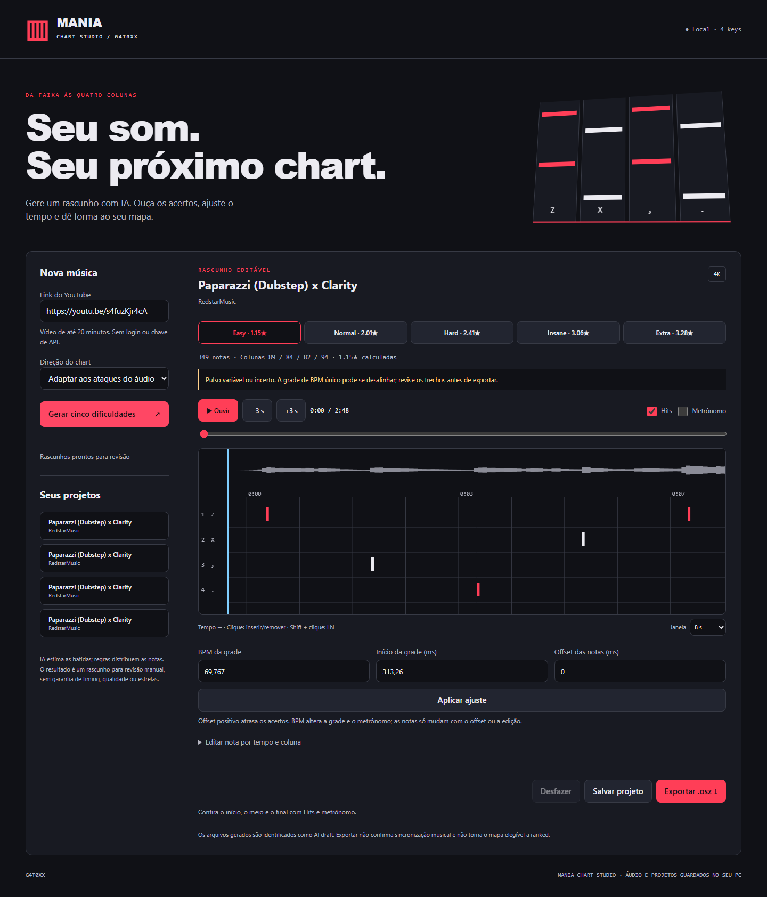

# Mania Chart Studio / G4T0XX

Aplicativo local para criar **rascunhos editáveis de osu!mania 4K** a partir de um vídeo do YouTube. Interface em português, cinco dificuldades, análise neural de batidas, waveform, áudio com hits sincronizados, metrônomo, editor de notas e exportação `.osz` com capa.



## Rodar no Windows

1. Instale **Python 3.11** e **FFmpeg** disponível no PATH (`ffmpeg -version`). O yt-dlp pode precisar de Node.js atualizado para os desafios de JavaScript do YouTube.
2. Baixe o ZIP do projeto, extraia e abra **Iniciar.cmd**. A primeira instalação baixa PyTorch e outras dependências e pode demorar.
3. O aplicativo abre em **http://127.0.0.1:8765**. Cole um link e escolha a direção do chart.
4. Ouça os acertos no começo, no meio e no final. Corrija o offset, insira/remova notas, salve e exporte o `.osz`.

Alternativa pelo terminal:

```powershell
py -3.11 -m venv .venv
.venv\Scripts\python -m pip install -r requirements.txt
.venv\Scripts\python start.py
```

Linux/macOS: Python 3.11, FFmpeg, `python -m venv .venv`, ative o ambiente, instale `requirements.txt` e execute `python start.py`.

## O que a IA faz

O modelo **[Beat This small0](https://github.com/CPJKU/beat_this)** estima batidas e compassos. A distribuição de notas usa **regras determinísticas sobre ataques espectrais do áudio**, e não um modelo treinado em charts humanos. Os estilos são sugestões; não há promessa de equivalência aos top plays de um jogador.

Notas de ataque preservam o tempo detectado no áudio em vez de serem empurradas automaticamente para uma grade incerta. A grade constante de BPM é uma proposta separada. Áudios com variação de tempo precisam de revisão mais profunda; esta versão não possui editor de múltiplos pontos de timing. Long notes são sugestões heurísticas, não transcrição confiável de notas sustentadas.

Estrelas são calculadas por `rosu-pp-py`; não são nomes inventados para as dificuldades. Não há garantia de atingir 3–7 estrelas. O aplicativo não infla densidade apenas para elevar o número.

## Revisar e editar

- **Ouvir / Espaço:** áudio e hits no mesmo relógio Web Audio. A latência física depende do dispositivo.
- **Hits:** ouça os ataques propostos sobre a música. **Metrônomo:** confira a grade.
- **Offset positivo:** atrasa as notas e a grade. O áudio permanece no mesmo lugar.
- **BPM / início da grade:** alteram a grade e o metrônomo; não reposicionam as notas automaticamente.
- **Clique na timeline:** insere ou remove uma nota. **Shift + clique:** cria LN de 300 ms.
- **Editar por tempo e coluna:** alternativa por teclado, inclusive para remover notas a até 40 ms do tempo informado.
- **Desfazer:** até 50 edições na sessão.
- **Salvar:** valida notas, rejeita sobreposições e recalcula estrelas de todas as dificuldades.
- **Exportar:** salva e cria pacote com cinco charts, áudio PCM e capa. Não instala nem modifica o osu! automaticamente.

## Modelo

O download usa HTTPS com validação de certificado e verificação SHA-256:

`6074be2c4d490c5f6101fcc374a1ec72ae93456e23bb6019783b849f5dc7d47b`

Se o servidor de modelos estiver indisponível ou com certificado inválido, a geração apresenta erro. Não desative TLS: obtenha `small0.ckpt` pela [página oficial de modelos](https://cloud.cp.jku.at/index.php/s/7ik4RrBKTS273gp) ou pelo asset verificado da release deste projeto e coloque em `models/small0.ckpt`. Também é possível definir `MANIA_MODEL_PATH`.

## Limites e privacidade

- Vídeos públicos gravados de até **20 minutos**. Playlists, transmissões ao vivo, vídeos indisponíveis, restritos ou protegidos não são contornados. Nem todo vídeo do YouTube poderá ser baixado.
- Use músicas para as quais você tenha autorização. Áudios de terceiros não são incluídos neste repositório nem na release.
- O resultado é **AI draft / unranked**, sem garantia de sincronização musical. A [política de IA do osu!](https://osu.ppy.sh/wiki/en/Ranking_criteria#ai-policy) se aplica à elegibilidade para ranked.
- Arquivos ficam em `data/`, modelo em `models/`; ambos ignorados pelo Git. Não há telemetria, coleta de credenciais ou necessidade de chave de API.
- Serviço limitado a `127.0.0.1`, sem CORS aberto, com validação de host/origem. Não publique este servidor diretamente na internet.
- Uma geração por vez. Se encerrar o servidor durante a geração, reinicie e tente gerar novamente; projetos concluídos continuam na biblioteca.
- Esta é uma primeira versão de editor local; não equivale a um mapeador humano nem substitui playtest.

## Desenvolvimento

```powershell
python -m pip install pytest httpx
python -m pytest -q
node --check web/app.js
```

Os testes verificam exportação, validação, isolamento de origem, links e API. Não certificam musicalidade. Os downloads e a inferência neural foram exercitados separadamente durante a validação local; veja `VALIDATION.md`.

## Créditos

Beat This, de Francesco Foscarin, Jan Schlüter e Gerhard Widmer, Institute of Computational Perception, JKU Linz (2024), código e pesos MIT. Veja `THIRD_PARTY_NOTICES.md`. Dependências conservam suas próprias licenças. Sem vínculo oficial com osu! ou YouTube.
